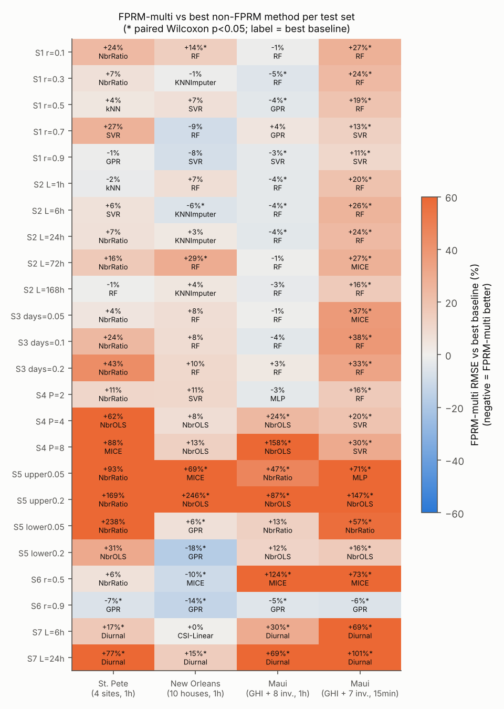
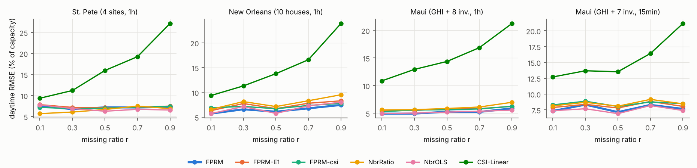
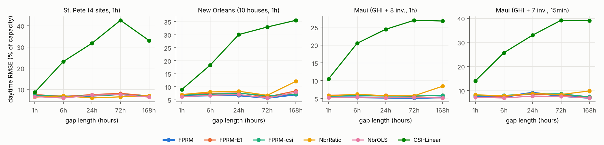
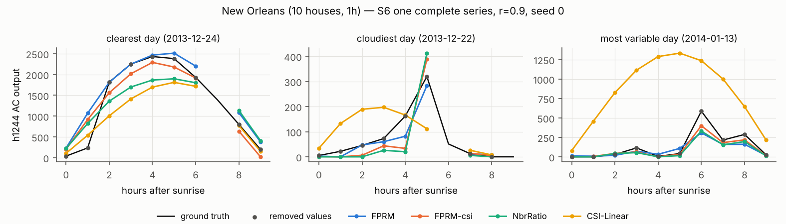
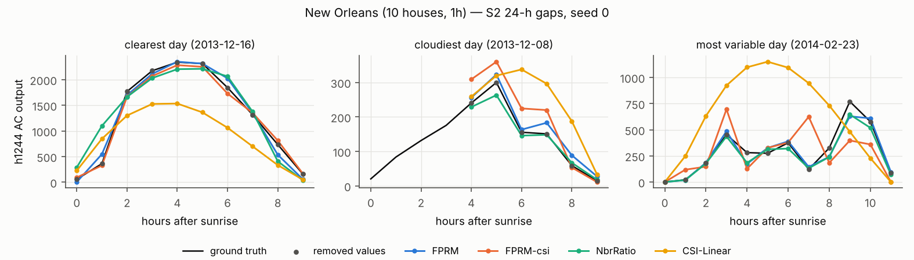

# FPRM 결측치 복원 기법의 태양광 데이터 적용 가능성 검증 — 결과 리포트

대상 논문: Wu et al., *Dynamics-informed machine learning for recovering extensive missing systems dynamics*, Nature Communications (2026), doi:10.1038/s41467-026-77922-1. 아래에서 FPRM(Full-Partial Reconstruction Mapping)이라 부른다.

## 1. 요약

**판정: 조건부로 쓸 만하다.** FPRM의 핵심 아이디어인 "완전 관측 참조 시계열의 지연 임베딩 → 결측 시계열 매핑"은 태양광 데이터에서도 실제로 효과가 있다.
다만 논문 원형(참조 1개 + GPR)을 그대로 쓰면, 이웃 사이트를 모두 쓰는 일반 회귀(RF·SVR·MLP)보다 대부분의 시나리오에서 정확도가 낮다.

1. **지연 임베딩 자체의 효과는 분명하다.** 같은 GPR에서 임베딩만 뺀 버전(FPRM-E1)에 비해 일반 결측(S1–S3)에서 RMSE가 중앙값 기준 7% 낮다. 참조 시계열을 무엇으로 바꿔도 31개 경우 모두 임베딩 쪽이 더 좋았다(5–30% 개선, S8).
2. **논문 원형(참조 1개)은 최강 베이스라인보다 12–16% 나쁘다.** S1–S3의 52개 셀 중 이긴 셀은 1개, 유의하게 진 셀은 35개다. 여기서 최강 베이스라인은 셀마다 사후에 고른 오라클이라 FPRM에 불리한 비교다.
   완전 관측 참조를 모두 임베딩하는 확장(FPRM-multi)은 격차를 5–9%로 줄인다. 17개 기법 중 **전체 평균 순위 1위**(5.7)다.
3. **FPRM이 확실히 이기는 곳은 논문이 강조한 극한 상황이다.** 완전 관측 시계열이 1개뿐이고 나머지가 90% 결측(S6, r=0.9)이면 4개 데이터셋 모두에서 최강 베이스라인보다 5–14% 좋고, 모두 유의하다(p<0.05).
4. **명확한 실패 조건이 셋 있다.**
   - 고출력 구간만 사라지는 MNAR(S5 upper): 학습 범위 밖 외삽이 안 돼 RMSE가 2–3배.
   - 저해상도 로깅(S4 P≥4): 관측 시각이 하루의 특정 시간대로 쏠리면 임베딩이 오히려 해롭다.
   - 전 변수 동시 결측(S7): 논문이 밝힌 한계 그대로, 참조가 없어 복원 불가.
5. **실무 권장.**
   - FPRM은 "이웃 발전소·인버터가 대부분 같이 빠지고 소수만 살아 있는 상황"의 전용 도구, 또는 앙상블 구성원으로 쓴다.
   - 매핑 학습기는 GPR 대신 SVR을 쓴다. 정확도는 같고 약 45배 빠르다.
   - 참조는 일사계(GHI)가 아니라 가장 상관이 높은 이웃 인버터로 고른다.

---

## 2. 구현과 논문 대비 차이점

구현 위치: `src/fprm/`

| 항목 | 논문 | 본 구현 |
|---|---|---|
| Full / partial reconstruction | Eq. 6, 9 (forward lag) | `delay_embed(..., direction="forward")`. 끝의 (E−1)τ 행은 완전 시계열의 마지막 값으로 채워 모든 시점에 벡터가 있게 함 |
| 매핑 F | GPR, SE 커널, θ = 예측변수 std 평균, 노이즈 σ² (Eq. 15–18) | scikit-learn GPR: `Const × RBF(θ₀ = mean std) + White`, `normalize_y`(MATLAB `fitrgp`의 constant basis 대응) |
| GPR 하이퍼파라미터 | 명시 없음. 원 코드 MATLAB (fitrgp 기본값 추정) | 고유 행 600개 부분표본에서 marginal likelihood 최적화(재시작 1회), 노이즈 하한 1e-4. 최종 GP는 최대 2,000개 학습점(subset of data, fitrgp의 n>2000 동작과 같음) |
| E, τ 선택 | Supp. Fig. S1(보충자료 미확보) | **관측값만으로 하는 교차검증**: 관측 목표값 600개 중 1/3을 검증용으로 두고, E∈{1,2,3,4,6,8} × τ∈{1,2,4} 격자 탐색. AMI+FNN 선택기도 구현함(`select="ami_fnn"`) |
| 정규화 | z-score | 관측값 통계로만 z-score |
| 참조가 없는 행 | (lag FPRM, 보충자료) | 미구현. 남은 결측은 clear-sky-index 선형보간으로 채우고 `n_fallback`으로 기록 |
| 논문에 없는 확장 | — | `refs="multi"`(완전 참조 전부의 임베딩 결합), `direction="backward"`(과거 방향 = 실시간 가능), clear-sky-index 공간 변환(`FPRM-csi`) |

- 논문 원 코드(figshare doi:10.6084/m9.figshare.30446765)는 실행 환경의 네트워크 정책으로 접근할 수 없었다. 그래서 논문 본문만 보고 구현했다.
- **"최적 참조 1개"(`refs="best"`)를 논문 원형 FPRM의 기본으로 썼다.** 관측 구간 상관이 가장 큰 완전 시계열을 고른다. 논문은 "완전 시계열 하나"만 가정하고 선택 규칙은 정하지 않았다.

### 2.1 합성계 재현 (`scripts/reproduce_synthetic.py`, 20회 반복)

x는 완전 관측이고, y·z에서 무작위로 r만큼 제거했다. 표의 값은 r=0.9에서의 평균 ρ / 정규화 RMSE다.

| 시스템 | 변수 | 논문 FPRM | 본 구현 FPRM-GPR | FPRM-SVR | GPR (E=1, 임베딩 없음) |
|---|---|---|---|---|---|
| 3D ecology (Eq. 3) | y | 0.99 / 0.11 | 0.997 / 0.059 | 0.992 / 0.122 | 0.184 / 1.010 |
| | z | 0.99 / 0.13 | 0.996 / 0.081 | 0.994 / 0.112 | 0.614 / 0.808 |
| 3D Lorenz (Δt=0.02) | y | 0.90 / 0.48 | 1.000 / 0.003 | 0.996 / 0.093 | 0.889 / 0.462 |
| | z | 0.81 / 0.68 | 0.978 / 0.204 | 0.923 / 0.400 | 0.650 / 0.765 |
| 3D Lorenz (Δt=0.06) | y | — | 1.000 / 0.020 | 0.997 / 0.075 | 0.878 / 0.483 |
| | z | — | 0.979 / 0.199 | 0.929 / 0.380 | 0.638 / 0.775 |

- **Ecology는 논문 수치와 일치한다.**
- **Lorenz는 논문보다 훨씬 좋게 나왔다.** 샘플링 간격을 3배로 늘려도 결과가 거의 같았다.
  - 논문의 Lorenz 설정(초기값, 샘플링, 관측 잡음, E·τ)이 본문에 완전히 나와 있지 않아 원인은 특정하지 못했다.
  - 공교롭게도 임베딩 없는 GPR의 y 결과(0.89/0.46)가 논문 FPRM 수치와 비슷하다.
  - 어느 쪽이든 결론은 같다. **임베딩이 성능을 만든다**: E=1이면 ρ가 0.2–0.65 수준으로 무너진다.
- 그림: `results/figures/synthetic_reproduction.png`. 전체 표: `results/tables/synthetic.csv`. pytest 재현 테스트: `tests/test_fprm.py::test_reproduces_paper_ecology_r05`.

---

## 3. 데이터와 테스트셋

자세한 내용은 `data/README.md`에 있다. 모든 데이터는 NREL PVDAQ 실측이며, OEDI 공개 S3에서 받았다.
nrel.gov, DKASC, PVGIS, data.go.kr 등은 네트워크 정책으로 차단돼 쓰지 못했다.

| ID | 구성 | 변수 | 해상도·길이 | 지정 참조 |
|---|---|---|---|---|
| `stpete_1h` | (A) 공간: 반경 약 10 km 공원 건물 4곳 | 4 | 1h × 3,624 | s1314 |
| `nola_1h` | (A) 공간: 주택 지붕형 10곳 | 10 | 1h × 3,624 | h1263 |
| `maui_1h` | (A)+(B): 한 건물의 스트링 인버터 8개 + 현장 GHI | 9 | 1h × 4,344 | GHI |
| `maui_15min` | (A)+(B): 인버터 7개 + GHI | 8 | 15min × 5,760 | GHI |

각 창은 결측이 전혀 없는 구간이다. 야간은 0으로 채웠고, 고장·시계 오류 채널은 제외했다.

### 3.1 결측 시나리오

정의는 `src/missingness.py`에 있다. 시나리오·파라미터마다 seed 5개를 썼다. 지시서 기본은 10개지만 계산량 때문에 5개로 줄였다.

| ID | 시나리오 | 파라미터 | 결측 변수 |
|---|---|---|---|
| S1 | MCAR 무작위 점 | r = 0.1, 0.3, 0.5, 0.7, 0.9 | 비참조 변수의 절반 |
| S2 | 연속 블록(통신 장애) | L = 1h, 6h, 24h, 72h, 168h (총 20%) | 〃 |
| S3 | 하루 통째 결측 | 5, 10, 20% 날짜 | 〃 |
| S4 | 주기 로깅(P step마다 1개만 저장) | P = 2, 4, 8 | 〃 |
| S5 | 임계값 MNAR | 상위 5·20%(포화/클리핑), 하위 5·20%(저조도 컷오프) | 〃 |
| S6 | 참조 1개만 완전 | r = 0.5, 0.9 | 참조를 뺀 전부 |
| S7 | 전 변수 동시 블록 결측 | L = 6h, 24h (총 10%) | 참조 포함 전부 |
| S8 | 참조 스윕 | 각 변수를 차례로 유일한 완전 참조로 둔 S6(r=0.5) | — |

실제 결측률과 공백 길이 통계는 `results/testsets_summary.csv`에 있다. 예를 들어 S1 r=0.9는 평균 공백 2.5–10 h, 최대 85 h다.
본 실험은 테스트셋 480개(4 데이터셋 × 24 파라미터 × 5 seed)와 17개 기법으로 이뤄졌다. 여기에 ablation 134개를 더 돌렸다.

### 3.2 평가 규칙

- **평가 시점**: 결측 위치 중 **주간(태양 천정각 < 85°)**만 본다. 야간 0값 때문에 지표가 부풀려지는 것을 막기 위해서다.
- **지표**: 주 지표는 정격용량(관측 99.9 백분위) 대비 RMSE %다. 논문 지표(ρ, σ로 정규화한 RMSE), MAE, bias, 결측 구간 에너지 합계 오차 %도 함께 계산했다. 전체 시점 기준 ρ·nRMSE(`rho_all`, `nrmse_all`)도 CSV에 있다.
- **공통 후처리**: 모든 기법에 같은 후처리를 적용했다. 음수는 0으로 자르고, 태양 천정각 ≥ 90°인 시점은 0으로 둔다.
- **누설 방지**: 모델·E·τ 선택은 관측값만 쓴다. 정답 값을 바꿔도 출력이 같다는 것을 테스트로 확인했다(`test_no_leakage_of_hidden_values`).
- **유의성**: (seed × 변수) 단위 paired Wilcoxon signed-rank 검정. St. Pete는 결측 변수가 1개뿐이라 표본이 5쌍이고, 유의성을 거의 낼 수 없다.

---

## 4. 결과

### 4.1 비교 기법

| 그룹 | 기법 |
|---|---|
| 단순 | Mean, Linear 보간, Diurnal(±7일 같은 시각 평균) |
| 태양광 실무 | CSI-Linear(clear-sky index 보간), NbrRatio(최고 상관 이웃 × ±3일 에너지 비율), NbrOLS(완전 시계열 전부에 대한 선형회귀) |
| 직접 ML 회귀 (완전 시계열 전부의 현재값 입력, 임베딩 없음) | kNN, GPR, SVR, RF, MLP |
| 다변량 대치 | MICE(IterativeImputer), KNNImputer |
| FPRM 계열 | FPRM(논문 원형, 최적 참조 1개), FPRM-E1(임베딩 제거), FPRM-multi(확장), FPRM-csi(CSI 공간) |

### 4.2 시나리오별 평균 순위

17개 기법을 (테스트셋 × 변수)마다 용량 대비 RMSE로 순위를 매긴 평균이다. 낮을수록 좋다.

| 기법 | S1 MCAR | S2 블록 | S3 하루 | S4 주기 | S5 임계 | S6 참조1 | S7 동시 | **전체** |
|:--|--:|--:|--:|--:|--:|--:|--:|--:|
| **FPRM** | 6.9 | 7.4 | 7.4 | 7.4 | 7.5 | **3.3** | 7.6 | 6.8 |
| **FPRM-multi** | 4.8 | 5.1 | 5.9 | 6.6 | 7.2 | **3.3** | 7.6 | **5.7** |
| FPRM-csi | 8.9 | 9.0 | 9.5 | 8.6 | 5.8 | 4.7 | 7.7 | 7.7 |
| FPRM-E1 | 9.6 | 10.0 | 9.8 | 7.3 | 7.5 | 6.3 | 7.6 | 8.3 |
| RF | **3.7** | **3.6** | **3.6** | 5.9 | 8.8 | 11.8 | 7.8 | 6.5 |
| SVR | 4.0 | 4.7 | 4.7 | 4.6 | 8.8 | 8.9 | 7.8 | 6.3 |
| MLP | 5.3 | 4.7 | 4.7 | 4.4 | 5.4 | 8.0 | 7.8 | 5.9 |
| kNN | 5.7 | 5.5 | 5.6 | 7.6 | 9.0 | 13.5 | 7.8 | 7.8 |
| GPR | 7.5 | 8.2 | 7.6 | 8.8 | 9.1 | 6.4 | 7.8 | 7.9 |
| NbrOLS | 7.0 | 7.5 | 7.6 | **3.8** | **4.4** | 9.2 | 7.8 | 6.9 |
| NbrRatio | 10.3 | 10.5 | 9.9 | 7.3 | 5.1 | 9.6 | 7.8 | 8.8 |
| MICE | 7.3 | 5.3 | 5.3 | 11.4 | 4.5 | 6.6 | 14.5 | 8.0 |
| KNNImputer | 10.1 | 9.7 | 9.3 | 10.9 | 11.3 | 9.0 | 14.3 | 10.8 |
| CSI-Linear | 14.4 | 14.9 | 15.2 | 12.5 | 12.6 | 10.5 | 7.8 | 12.4 |
| Diurnal | 15.5 | 14.5 | 14.0 | 16.6 | 15.9 | 11.7 | **3.9** | 12.8 |
| Linear | 15.0 | 16.0 | 16.9 | 13.5 | 13.7 | 13.4 | 13.3 | 14.5 |
| Mean | 16.9 | 16.3 | 15.8 | 15.6 | 16.4 | 16.7 | 14.3 | 16.0 |

### 4.3 시나리오별 주간 RMSE (% of capacity, 전 데이터셋·seed·변수 중앙값)

| 기법 | S1 | S2 | S3 | S4 | S5 | S6 | S7 |
|:--|--:|--:|--:|--:|--:|--:|--:|
| FPRM | 6.2 | 6.1 | 5.8 | 7.8 | 6.4 | 14.8 | 24.2 |
| FPRM-multi | 5.6 | 5.5 | 5.6 | 7.3 | 6.9 | 14.8 | 24.2 |
| FPRM-E1 | 6.7 | 6.7 | 6.4 | 7.1 | 7.2 | 15.9 | 24.2 |
| RF | 5.6 | 5.4 | 5.2 | 7.0 | 8.7 | 17.0 | 24.2 |
| SVR | 5.6 | 5.5 | 5.3 | 6.8 | 7.7 | 16.1 | 24.2 |
| NbrOLS | 6.1 | 6.0 | 5.7 | 6.4 | 4.7 | 16.1 | 24.2 |
| NbrRatio | 6.5 | 6.8 | 6.1 | 7.0 | 5.1 | 16.2 | 24.2 |
| MICE | 6.2 | 5.7 | 5.1 | 15.1 | 5.0 | 9.7 | 38.8 |
| CSI-Linear | 13.9 | 24.9 | 31.4 | 13.0 | 13.8 | 18.0 | 24.2 |
| Diurnal | 19.6 | 17.8 | 18.1 | 54.5 | 24.7 | 20.3 | 18.5 |

S7의 24.2는 대부분 기법이 참조 부재로 CSI-Linear 폴백에 떨어진 값이다.

- **ρ (S1–S3 중앙값)**: 대부분 기법이 0.976–0.985다. 상관만 보면 차이가 거의 없으므로 실무 판단은 RMSE와 에너지 오차로 해야 한다.
- **결측 구간 에너지 합계 오차 (S1–S3 중앙값)**: FPRM 0.6–1.0%, RF 0.5–0.8%, CSI-Linear 2–17%, Linear 6–100%.
- 전체 표: `results/tables/rmse_cap_pivot.csv`, `main_by_param.csv`, `mean_rank_by_scenario.csv`.

### 4.4 FPRM vs 셀별 최강 베이스라인

요약은 `results/tables/family_summary.csv`, 히트맵은 `results/figures/fprm_vs_best_heatmap.png`, `fprm_multi_vs_best_heatmap.png`에 있다.

| 시나리오 | 셀 수 | FPRM 중앙 상대오차 | FPRM 승/유의승/유의패 | FPRM-multi 중앙 상대오차 | multi 승/유의승/유의패 | FPRM vs FPRM-E1 |
|---|--:|--:|--:|--:|--:|--:|
| S1 MCAR | 20 | +11.7% | 1 / 0 / 12 | +5.4% | 8 / 3 / 6 | −7.6% |
| S2 블록 | 20 | +13.6% | 0 / 0 / 14 | +4.9% | 8 / 4 / 6 | −7.0% |
| S3 하루 | 12 | +15.8% | 0 / 0 / 9 | +9.1% | 2 / 0 / 3 | −7.3% |
| S4 주기 | 12 | +18.3% | 0 / 0 / 7 | +17.8% | 1 / 0 / 5 | +3.3% |
| S5 임계 | 16 | +43.8% | 0 / 0 / 11 | +63.1% | 1 / 1 / 9 | −0.5% |
| **S6 참조1** | 8 | **−5.3%** | **5 / 5 / 2** | −5.3% | 5 / 5 / 2 | −6.6% |
| S7 동시 | 8 | +49.3% | 0 / 0 / 7 | +49.3% | 0 / 0 / 7 | 0.0% |

"최강 베이스라인"은 셀마다 13개 비-FPRM 기법 중 사후에 고른 최저 RMSE 기법이다. 이 오라클 선택 때문에 비교가 FPRM에 불리하다. 고정된 기법과 비교하려면 4.2의 순위표를 보면 된다.







### 4.5 S6: 완전 관측 시계열이 1개뿐일 때 (논문의 핵심 상황)

용량 대비 RMSE %, 5 seed × 모든 결측 변수 평균.

| 데이터셋 | r | 참조 | FPRM | FPRM-E1 | NbrRatio | RF | MICE | 최강 베이스라인 |
|---|---|---|--:|--:|--:|--:|--:|---|
| St. Pete | 0.5 | s1314 | 8.14 | 8.51 | **7.67** | 9.14 | 7.94 | NbrRatio |
| | 0.9 | | **8.03** | 8.60 | 9.74 | 9.10 | 9.58 | GPR 8.60 |
| New Orleans | 0.5 | h1263 | **7.04** | 8.70 | 8.93 | 9.48 | 7.86 | MICE |
| | 0.9 | | **7.65** | 8.85 | 10.34 | 9.54 | 18.23 | GPR 8.85 |
| Maui 1h | 0.5 | GHI | 15.72 | 16.85 | 16.37 | 18.29 | **7.00** | MICE |
| | 0.9 | | **16.19** | 17.00 | 17.86 | 18.28 | 24.21 | GPR 17.00 |
| Maui 15min | 0.5 | GHI | 17.38 | 18.69 | 19.19 | 20.22 | **10.03** | MICE |
| | 0.9 | | **17.74** | 18.82 | 19.63 | 20.45 | 25.22 | GPR 18.82 |

- **r=0.9에서는 FPRM이 4/4 데이터셋에서 1위다.** 단일 참조에서 정보를 가장 잘 뽑아내는 방법은 임베딩이었다.
- **r=0.5에서는 MICE가 크게 이길 때가 있다(Maui).** MICE는 같은 시각에 *부분적으로* 관측된 다른 인버터들을 활용한다. 반면 FPRM(논문 원형)은 완전 시계열만 입력으로 쓰므로 그 정보를 버린다. 이것이 태양광 적용 시 FPRM의 구조적 약점이다. 이웃 사이트가 동시에 다 빠지는 경우는 드물기 때문이다.
- **Maui는 참조가 GHI 일사계라 모든 기법의 오차가 크다(15–18%).** 다음 절의 참조 선택 문제와 이어진다.



### 4.6 실패 사례와 원인

**S5 상위 임계 (포화·클리핑 구간 결측)**

- 상위 20% 결측에서 FPRM의 RMSE는 12–23%다. NbrOLS·NbrRatio는 5.9–8.8%로, FPRM이 2–3배 나쁘다.
- 원인: 학습 데이터에 고출력 상태가 아예 없다. 그래서 GPR(그리고 RF·kNN·SVR)은 학습 범위 밖을 외삽하지 못하고 평균 쪽으로 수축한다.
- 선형 구조인 NbrOLS·NbrRatio는 비례 관계로 외삽할 수 있어 강건하다.
- FPRM-csi는 clear-sky 정규화 덕분에 상대적으로 낫다(평균 순위 5.8). 정규화된 공간에서는 "고출력"이 덜 극단적이기 때문이다.

**S4 주기 로깅 (P=4, 8)**

- Maui 1h의 P=8에서 FPRM은 14.2%, FPRM-E1은 8.7%, NbrOLS는 5.7%다.
- 원인: 하루 24 step에서 P step마다 1개만 남으면 관측 시각이 하루 중 같은 몇 시간대로 고정된다. 교차검증도 그 시간대 안에서만 이뤄지므로 큰 E·τ가 선택된다.
- 이렇게 고른 임베딩 매핑은 관측된 적 없는 시간대(끌개의 다른 부분)로 일반화되지 않는다.
- 같은 이유로 Diurnal은 그 시간대 정보가 전혀 없어 값을 0으로 낸다. S4 에너지 오차가 100%인 것은 이 때문이다.

**S7 전 변수 동시 결측**

- 참조가 없으므로 FPRM은 원리적으로 복원할 수 없다(논문의 "lag FPRM" 확장은 보충자료를 구할 수 없어 구현하지 못했다).
- FPRM 계열 출력은 전부 폴백인 CSI-Linear와 같다.
- 이 경우는 같은 시각의 과거 패턴(Diurnal)이 가장 좋다(평균 순위 3.9).

**MICE 발산**

- S4(주기 결측)에서 MICE는 수치적으로 발산했다. 평균 RMSE가 10⁴⁵ 수준이다.
- 그래서 4.3의 표는 중앙값으로, 4.2는 순위로 요약했다.

### 4.7 Ablation (`configs/ablation.yaml`, 3 seed)

S1 r=0.5·0.9, S2 L=6h·24h, S6 r=0.5·0.9 × 4 데이터셋에서 측정했다. 값은 용량 대비 RMSE % 평균, 학습+추론 시간은 대상 변수당 초.

| 변형 | 내용 | RMSE % | 시간(s) |
|---|---|--:|--:|
| FPRM | GPR, forward, 최적 참조 | 8.67 | 6.9 |
| FPRM-SVR | 매핑을 SVR로 (논문 SVM*) | 8.73 | **0.15** |
| FPRM-MLP | 매핑을 MLP로 (논문 NN*) | 8.76 | 2.0 |
| FPRM-back | 과거 방향 임베딩 (실시간 가능) | **8.60** | 6.7 |
| FPRM-csi | clear-sky index 공간 | 8.92 | 6.3 |
| FPRM-E1 | 임베딩 제거 | 9.26 | 1.9 |
| FPRM-E1-csi | 임베딩 제거 + CSI | 9.67 | 1.8 |
| FPRM-ref | 지정 참조(Maui = GHI) 고정 | 12.31 | 6.8 |

- **학습기 선택**: 논문 Table 1처럼 GPR·SVR·NN 간 차이가 작다. SVR은 약 45배 빠르다.
- **실시간 사용**: 과거 방향 임베딩은 성능 손실이 없다. 따라서 실시간(온라인) 복원에도 쓸 수 있다.
- **CSI 변환**: clear-sky index 변환은 평균적으로 이득이 없다. 단, S5에서는 이득이 있다.
- **참조 선택의 영향이 가장 크다.** S1·S2에서 GHI를 참조로 고정하면 Maui RMSE가 5.5–7.6%(최적 인버터 참조) → 16.3–17.7%로 2–3배가 된다. 같은 조건에서 New Orleans·St. Pete의 지정 이웃 참조는 차이가 0.3–0.7%p에 그친다.

### 4.8 S8 참조 스윕: 무엇을 참조로 쓸 것인가

각 변수를 차례로 유일한 완전 참조로 두었다(S6 마스크, r=0.5, 2 seed). 출처: `results/tables/refsweep.csv`.

| 데이터셋 | FPRM-ref 범위 (평균) | FPRM-E1 범위 | NbrRatio 범위 | 임베딩 이득 (FPRM vs E1) |
|---|---|---|---|---|
| St. Pete | 7.0–8.2 (7.6) | 7.7–8.7 | **6.3–7.8** | −5 ~ −14% |
| New Orleans | **7.1–9.9 (8.4)** | 8.7–14.1 | 8.9–17.1 | −16 ~ −30% |
| Maui 1h | **6.2–15.7 (8.1)** | 7.0–16.9 | 7.3–16.5 | −7 ~ −20% |
| Maui 15min | **8.5–17.4 (10.9)** | 9.6–18.7 | 10.2–19.2 | −6 ~ −15% |

- **임베딩은 31개 참조 모두에서 이득이다(평균 −9 ~ −21%).** 태양광에서도 "참조 시계열의 지연 좌표가 대상 시계열 상태를 더 잘 결정한다"는 FPRM의 전제가 성립한다.
- **New Orleans·Maui에서는 모든 참조에 대해 FPRM-ref가 NbrRatio보다 좋다.** 방위각이 서로 다른 주택(일중 피크 시각 10–13시)처럼 이웃과 형태가 다를수록 비선형 매핑의 이점이 커진다.
- **St. Pete에서는 4개 참조 모두 NbrRatio가 더 좋다.** 4개 공원 건물의 출력 프로파일이 거의 비례하기 때문이다(상관 0.98).
- **Maui에서 GHI를 참조로 쓰면 최악이다(15.7–17.4%).** 인버터를 참조로 쓰면 6–10%다.
  - 일사계는 설치 위치·방향·시계 정합 문제로 어레이 출력과의 상관(0.90–0.94)이 인버터끼리의 상관(0.97–0.99)보다 낮다.
  - **물리량(일사량) 참조보다 같은 종류의 이웃 출력 참조가 낫다.**



---

## 5. 결론, 권장 사항, 한계

### 5.1 질문별 답

1. **현실적인 태양광 결측 패턴에서 FPRM이 더 나은가?**
   - 논문 원형은 이웃 사이트·인버터가 여럿 살아 있는 일반 상황에서 일반 ML 회귀(RF·SVR·MLP)보다 대체로 10–15% 나쁘다. 그래도 단순 보간·일사량 기반 방법보다는 훨씬 낫다. 에너지 합계 오차는 1% 이하다.
   - 완전 참조를 모두 쓰는 FPRM-multi는 상위권과 대등하다. 평균 순위로는 전체 1위다.
2. **어디서 잘 되고 어디서 실패하는가?**
   - **잘 되는 곳**: 완전 관측 시계열이 1–2개뿐이고 나머지가 대량 결측인 극한 상황(S6). 이웃 간 일중 형태가 다른 이질적 군집(New Orleans).
   - **실패하는 곳**: 고출력 구간 결측(외삽), 시간대가 쏠린 저해상도 관측, 전 변수 동시 장애. 결측률이 낮고 이웃이 균질한 경우(St. Pete)에는 단순 비율 스케일링을 넘지 못한다.
3. **실무 권장 설정**
   - 참조는 일사계가 아니라 **관측 구간 상관이 가장 높은 이웃 출력 시계열**로 고르고, 가능하면 여러 개를 결합한다(FPRM-multi).
   - 매핑 학습기는 **SVR**을 쓴다. 정확도는 GPR과 같고 계산은 약 45배 빠르다. GPR을 쓰면 야간 중복 행을 제거한 뒤 하이퍼파라미터를 최적화해야 한다. 그러지 않으면 노이즈 0의 과적합 해로 수렴한다(구현 중 실제로 확인한 문제다).
   - 실시간 복원이 필요하면 **과거 방향 임베딩**을 쓴다. 성능 손실이 없다.
   - E·τ는 관측값 교차검증으로 고른다. 주기 로깅처럼 관측 시각이 쏠린 데이터에는 E=1로 제한하거나 NbrOLS를 쓴다.
   - **운영 파이프라인**: 결측 패턴을 진단해 분기한다.
     - 동시 장애 → Diurnal/CSI
     - 고출력 결측 의심 → NbrOLS·NbrRatio
     - 이웃 대부분이 결측이고 소수만 완전 → FPRM
     - 그 외 → RF/SVR 또는 FPRM-multi 앙상블

### 5.2 한계와 후속 과제

- **데이터 접근**: 네트워크 정책 때문에 NREL PVDAQ만 사용했다. 한국 발전소, DKASC, NSRDB 위성 일사량을 쓴 검증, 그리고 논문 원 MATLAB 코드와의 대조가 남아 있다.
- **반복 수**: seed 5개(ablation 3개)로 줄였다. St. Pete는 결측 변수가 1개라 유의성 검정력이 낮다.
- **창 길이**: 데이터 창이 5–6개월이라 계절 변화 전체를 다루지 않는다. 연 단위 데이터라면 GPR 학습점 상한(2,000)의 영향이 커질 수 있다.
- **미구현 확장**:
  - lag FPRM(동시 결측 대응)은 보충자료(Supp. Fig. S15–S17)를 구할 수 없어 구현하지 못했다.
  - 부분 관측 이웃까지 입력으로 쓰는 변형(MICE와 FPRM의 결합)은 S6 r=0.5 결과로 보아 가장 유망한 후속 과제다.
  - S-map/MVCM, 딥러닝 대치(SAITS/BRITS)는 다루지 않았다.
- **E·τ 선택의 불안정성**: 교차검증 결과가 seed에 따라 E=2–8로 흔들린다. 선택 방법(Supp. Fig. S1)을 확인하면 개선될 여지가 있다.
- **데이터 품질**: Maui 인버터 채널의 단위는 명목상 kWh다. 일사계와 인버터의 시계 오프셋은 상관 최대화로 추정했다. 그 오차가 GHI 참조 성능을 낮췄을 가능성이 있다.

---

## 부록: 재현 방법과 산출물

```bash
pip install numpy scipy pandas scikit-learn matplotlib pvlib pyarrow pyyaml pytest
python -m pytest -q tests                         # 단위 + 재현 테스트
python scripts/reproduce_synthetic.py --reps 20   # 합성계 재현 (약 1.5 h, 4코어)
# 데이터: data/README.md 참고 (data/processed/*.parquet 는 저장소에 포함)
python scripts/make_testsets.py --datasets maui_15min,maui_1h,stpete_1h,nola_1h --seeds 5
python scripts/run_benchmark.py --config configs/main.yaml       # 약 3 h, 4코어
python scripts/run_benchmark.py --config configs/ablation.yaml   # 약 1 h
python scripts/make_report.py                                    # 표와 그림
```

| 산출물 | 경로 |
|---|---|
| 원시 결과 (tidy CSV, 행 = 테스트셋 × 기법 × 변수) | `results/main/metrics.csv`, `results/ablation/metrics.csv`, `results/synthetic/reproduction.csv` |
| 집계표 | `results/tables/` |
| 그림 | `results/figures/` |
